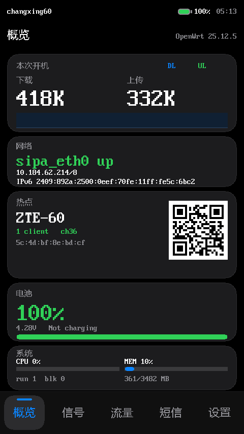
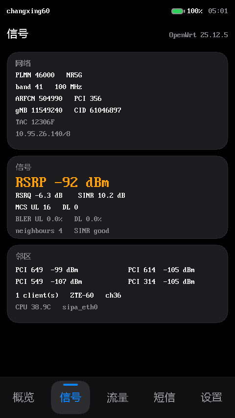

# changxing60-openwrt-tools

**ZTE 7552N（中兴畅行60）装 OpenWrt 的工具与文档。**

[](LICENSE)
[](#前置条件)
[](https://openwrt.org)
[](#改了什么)
[](https://github.com/humanxp/changxing60-openwrt-tools/releases)

派生自 [6Leokk/changxing60-linux](https://github.com/6Leokk/changxing60-linux) @ `163c004`
（它本身 fork 自 [dikeckaan/mu300-linux](https://github.com/dikeckaan/mu300-linux)，同为展锐 UMS9620 平台）。

> 本仓库不复制上游代码，只做叠加：把「装一台」从**几小时的内核编译**压缩成**下载 + 一条命令**。
> 逐项差异见 [`docs/CHANGES-VS-UPSTREAM.md`](docs/CHANGES-VS-UPSTREAM.md)。

---

## 截图

设备自带的中文状态面板（480×854 内屏，直接读屏，非手机翻拍）：

> 全部页面与弹窗（概览/信号/流量/短信/设置、电源、热点、温度、重启确认）见 [`docs/SCREENSHOTS.md`](docs/SCREENSHOTS.md)。

<table>
<tr>
<td></td>
<td></td>
</tr>
<tr>
<td align="center"><b>概览</b>：运行时长 / 实时速率 / <code>sipa_eth0</code> 与 IPv6 / 热点二维码 / 电池 / CPU·内存</td>
<td align="center"><b>信号</b>：NR5G band 41 100 MHz / PCI / RSRP −92 dBm / SINR 10.2 / 邻区</td>
</tr>
</table>

---

## 一条命令安装

```sh
git clone https://github.com/humanxp/changxing60-openwrt-tools.git
cd changxing60-openwrt-tools
scripts/install-from-release.sh --tag v1.1.4
```

脚本会做完整流程：下载并校验 [Release v1.1.4](https://github.com/humanxp/changxing60-openwrt-tools/releases/tag/v1.1.4)
资源 → 检查设备（型号 / slot / root / 空闲区）→ **用目标机自己的 `boot_a` 生成 boot 镜像** →
解包 rootfs → 写 `boot_b` → 写 `misc` → 重启。

> ⚠️ 目标机必须**已 root** 且 **userdata 已缩出 64 GiB 空闲区**。原厂机先看
> [`docs/INSTALL-NEW-PHONE.zh-CN.md`](docs/INSTALL-NEW-PHONE.zh-CN.md) §3——
> 那一步不可逆、会清 Android 数据，本仓库不自动化它。

装完 60–90 秒：

```sh
ssh root@192.168.77.1 'ubus call system board | head -4; uname -r'
# OpenWrt 25.12.5 / 5.4.254-gb50db5b6224c
```

默认热点 `Changxing60` / `changxing60`，装完请立刻改；root 密码是安装时你输入的那个。

---

## 改了什么

| # | 上游做法 | 这里改成 | 收益 |
|---|---|---|---|
| 1 | Docker 里编译 ZTE 5.4 GPL 源码 + wlan/mali 出树模块，小时级 | 从一台已装好的 7552N 的 `boot_b` 提取**未压缩 arm64 Image**（32,002,560 B）+ `/lib/modules/*.ko` | 秒级拿到与设备完全一致的内核，无 ABI 错配 |
| 2 | `install.sh` 用 Docker 现场编 `busybox` / `logdw` / `bt-init` | 从已装好的 boot ramdisk 里解出 static arm64 的 `busybox`、`logdw`、`ueventd-perms.sh`、Android 子集 | **整条链不需要 Docker** |
| 3 | 手工拼 `build-boot-image.py` 的 8 个参数 | `scripts/build-boot-for-target.sh` / `install-from-release.sh` 自动完成 | 不会用错另一台机器的 boot 头 |
| 4 | 检查散在 `install.sh`、且要求 Docker | 独立的前置检查：工具链 / 校验和 / 设备型号 / slot / root / 空闲区 | 失败发生在写入之前 |
| 5 | 无 | 预置 rootfs（已脱敏）+ Release 资源 | 装完就是调优过的状态 |
| 6 | 无 | 三份文档：agent 交接、人读安装、差异说明 | 换人/换 agent 可复现 |

## 优化了什么

同卡同小区，Android 300+ Mbps，OpenWrt 只有约 200 Mbps。定位到瓶颈是**单核软件转发**：
`sipa_eth0` 只有一个队列、SIPA 中断全落在 CPU0（A55 @768 MHz）、`nft` 里没有任何 offload、
`sfp_core` 加载了但引用计数为 0。

1. **软件 flow offload 真正生效** —— 默认 `flowtable ft` 只含 `{ br-lan, br-wifi }`，缺真实网口，
   Wi-Fi 流量进不了表。补上 `sipa_eth0 / usb0 / wlan0`，并解决「fw4 比 wlan0 起得早」和
   「表已存在时 reload 报 `Resource busy`」两个时序/竞态问题（开机不建表 → 接口齐全后临时开启重建 → 再置回 0）。
2. **RPS** —— `sipa_eth0` 的 `rx-0` 设 `0x80`，收包软中断从 CPU0 挪到 CPU7（A76）。
3. **CPU governor** —— 全部 `performance`，CPU0 768 MHz → 2002 MHz。

结果：实测**超过 200 Mbps**。flow offload 是主要贡献，RPS/governor 帮收包与首包。
设备侧附带 `/etc/hotplug.d/iface/99-flowtable`（开机钩子）与 `/etc/flowtable-on.sh`（reload 后恢复）。

## 没改什么

- 启动机制（slot b + `misc` 32 字节 + 试启动回落）
- 分区几何（`OFF=77858865152` / `SIZE=50096766976`）
- 内核补丁、驱动移植、rootfs 构建脚本
- 上游 `install.sh` / `uninstall.sh`——未改一行

---

## 仓库结构

```
.
├── docs/
│   ├── CHANGES-VS-UPSTREAM.md      与上游逐项差异 + 性能定位证据
│   ├── INSTALL-NEW-PHONE.zh-CN.md  安装说明（已 root+已扩区 / 原厂未动）
│   ├── NEW-PHONE-INSTALL-GUIDE.md  交接给 agent 的自包含教程
│   └── images/                     设备状态面板截图
├── scripts/
│   ├── install-from-release.sh     ★ 下载资源并一键安装
│   ├── build-boot-for-target.sh    只生成目标机 boot 镜像
│   └── install-new-phone.sh        走上游 install.sh 的包装（需 Docker）
├── tools/
│   ├── cxnow.c                     当前节点 + 延时（面板「节点」行）
│   └── screen-ui/                  内屏界面源码：base 绘制程序 + overlay + 构建脚本
└── vendor/                         上游 MIT 脚本的只读副本（见 vendor/NOTICE.md）
```

## 前置条件

| 项 | 要求 |
|---|---|
| 机型 | ZTE 7552N（`ro.product.device=P720S20`，`ro.board.platform=ums9620`） |
| Android | 在 **slot a** 启动，已 root（`su -c id -u` = 0），USB 调试开 |
| 空闲区 | userdata 已缩到 64 GiB，Linux 区（扇区 152,068,096 起）已腾出 |
| 主机 | `adb`、`python3`、`openssl`、`curl`；**不需要 Docker** |

## 验证记录

2026-11-19，真机 ZTE 7552N（P720S20）用本仓库的 Release 资源 + `install-from-release.sh` 完整走了一遍：

| 步骤 | 结果 |
|---|---|
| 资源下载 / SHA256 校验 | ✅ |
| 设备检查（型号 / slot a / root / 空闲区） | ✅ |
| 目标机 boot 镜像生成 | ✅（与本地构建 sha 一致，可复现） |
| rootfs 写入 + boot_b + misc | ✅ `CHANGXING60-INSTALL-OK` |
| 首次启动 | ❌ 上游 HEAD 的 `init` 在 `switch_root` 后网络不通（NCM 有、DHCP 无） |
| 换用实测可用的 `init` 后 | ✅ 启动、DHCP、5G WAN（ping 2/2）、flowtable 五设备、SSID `Changxing60` |

因此 `vendor/boot/init` 固定为**实测可用**的版本（见 `vendor/NOTICE.md`）。
如果你自己构建时遇到"USB 网卡有、拿不到 IP"，先检查 init 版本。

2026-11-19 晚：**格式化 Linux 区 + 从 GitHub 下载 v1.1.4 + 安装**，端到端复跑一次：

| 检查 | 结果 |
|---|---|
| 下载 + SHA256 | ✅ 4 个资源 |
| ext4 重建 + 解包 | ✅ `CHANGXING60-INSTALL-OK` |
| boot_b / misc | ✅ |
| 启动耗时 | ⏱ 约 **5 分钟**（新格式化的区首次启动较慢） |
| 系统 | ✅ OpenWrt 25.12.5 / 5.4.254-gb50db5b6224c |
| 面板二进制 | ✅ `2d2062c7…`（含两处卡顿修复） |
| flowtable | ✅ 五设备齐全 |
| 5G WAN | ✅ ping 通 |
| ShellCrash | ✅ 在，无配置、无自启 |
| 个人数据 | ✅ 0 命中 |


## 已知坑

1. **别用 `sysupgrade`**，别刷通用 arm64 OpenWrt 镜像。
2. `apk upgrade` 可以，但要排除 `kernel` / `kmod-*`。
3. 任何 `fw4 reload` 都会冲掉 flowtable，跑 `/etc/flowtable-on.sh` 恢复。
4. 首次启动是试启动，70 秒内别连着重启两次。
5. 装完立即改 root 密码与热点密码（Release 里的 rootfs 已脱敏，但默认值仍应替换）。
6. **启动偶发失败**：本机实测约一半概率卡在 `switch_root` 之后（USB 网卡在、无 DHCP、串口无输出），强制重启一次通常即可进入。同一镜像重启可成功，不是镜像内容问题。
7. 内屏页签卡顿已修（v1.1.4，见 [`docs/PANEL-FLIP-FIX.md`](docs/PANEL-FLIP-FIX.md)）；内核 `Bad page state`（显示驱动重复释放 logo 页）仍在，属驱动问题。

## 隐私

仓库与 Release **不含任何个人配置**：

- Release 的 rootfs **包含 ShellCrash 应用本体**（CrashCore、mihomo、菜单、UI、规则集），但已删除订阅地址与 token、`yamls/`、`config.yaml*`、`cache.db` 等个人配置，且**关闭了开机自启**；首次使用请自行 `crash` 导入订阅，再 `/etc/init.d/shellcrash enable`；
- SSH 主机密钥、root 密码哈希、热点 PSK 均已重置为通用默认值；
- 设备序列号、IMEI、账号信息不进入镜像。

> v1.0.0 曾误带一份 ShellCrash 配置，已删除该 Release 并由 v1.1.4 取代。

## 许可与免责

脚本与文档：[MIT](LICENSE)。`vendor/` 与上游代码、内核补丁：MIT / GPL-2.0，版权归原作者。

实验性工具，无担保。写 `boot_b` / `misc` / 缩分区都可能让设备无法启动，恢复需要 SPD/BROM 与厂商固件；
后果由设备所有者承担。


## 内屏（v1.1.4）

- 设置页：`切安卓 / 重启` 一行，`亮度 / 电源` 一行；重启先确认。
- 电源菜单：充电上限 80/90/100%，CPU 模式 省电/均衡/性能，点选即时生效。
- ShellCrash 区块显示当前节点名和延迟（`cxnow`）。
- 默认 CPU 调速器 `schedutil`、充电上限 80%（长期插电更护电池）。


## ShellCrash 网页管理

终端 `crash` 菜单的网页版（无 JavaScript）：`http://192.168.7.1/cgi-bin/shellcrash-ui`，
说明见 [`docs/SHELLCRASH-WEB.md`](docs/SHELLCRASH-WEB.md)。
