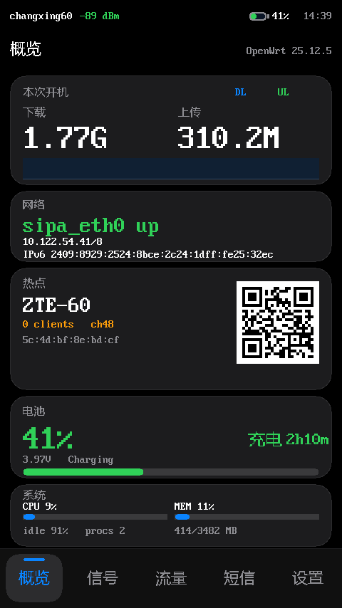
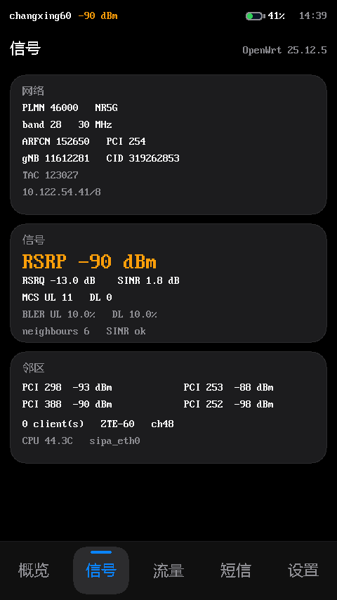
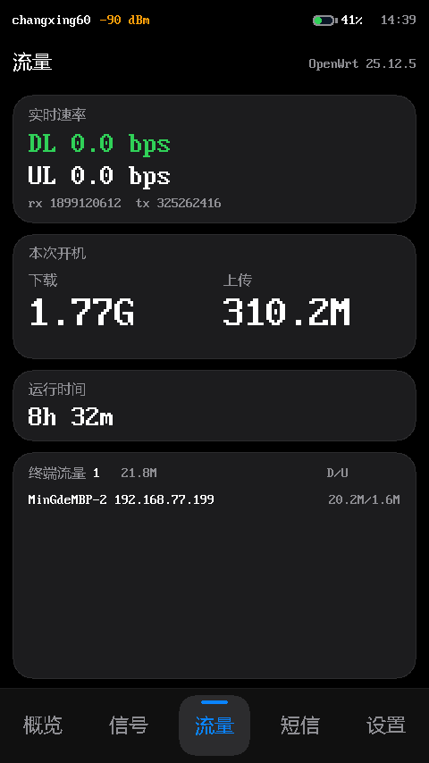
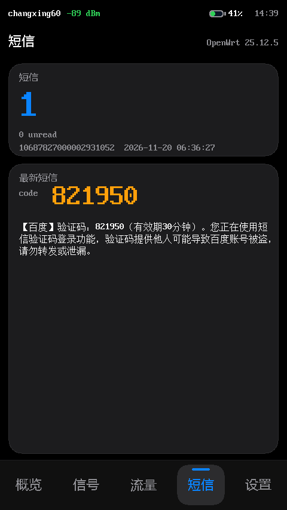
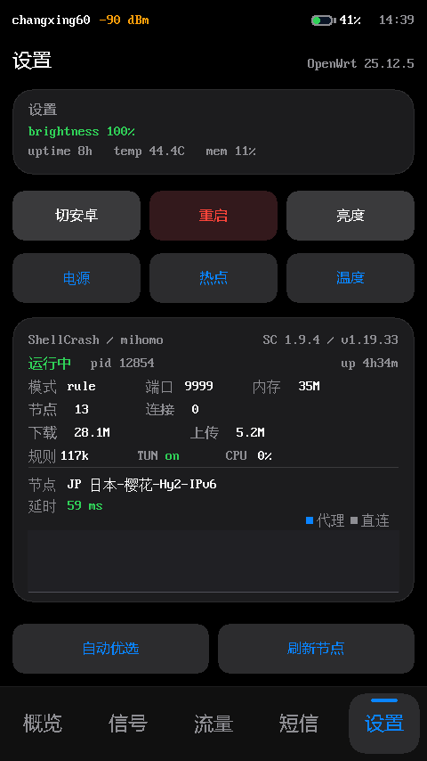
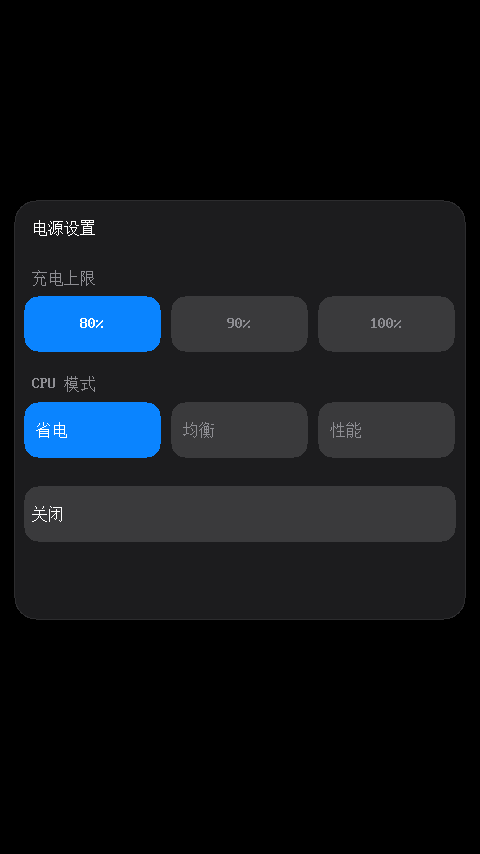
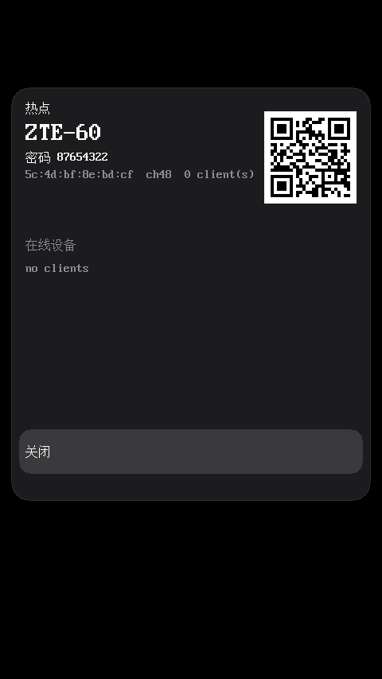
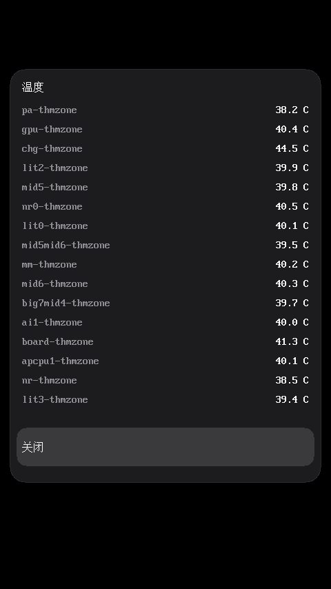
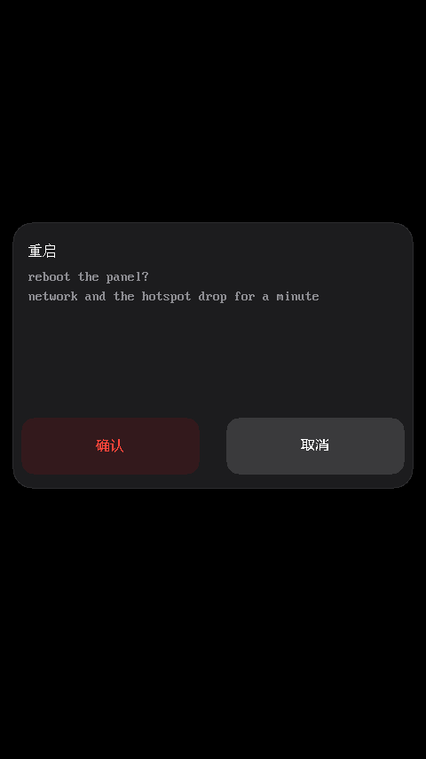

# 内屏截图

都是在设备上跑 `changxing60-screen --shot` 抓的真实帧（480×854），不是渲染稿。
数据是截取当时的真实状态。

| 页面 | 截图 |
|---|---|
| 概览 |  |
| 信号 |  |
| 流量 |  |
| 短信 |  |
| 设置 |  |

| 弹窗 | 截图 |
|---|---|
| 电源（充电上限 / CPU 模式） |  |
| 热点（SSID / 密码 / 二维码 / 踢人） |  |
| 温度（所有 thermal zone） |  |
| 重启确认 |  |

## 怎么自己抓

```sh
ssh root@192.168.77.1 '/etc/init.d/changxing60-screen stop'
ssh root@192.168.77.1 'CX_WAIT=1 CX_PAGE=0 /usr/bin/changxing60-screen --shot /tmp/p0.ppm'
ssh root@192.168.77.1 '/etc/init.d/changxing60-screen start'
```

- `CX_PAGE=0..4` 选页面（概览/信号/流量/短信/设置）；
- `CX_OVERLAY=power|hotspot|temp|reboot` 打开对应弹窗；
- `CX_WAIT=1` 等异步的信号数据就绪再画，否则信号页会是 `AT busy`；
- `--shot` 直接把画好的帧写成 PPM（480×854×3），不需要停面板也能跑，但 DRM 被占用时
  要先停服务。
